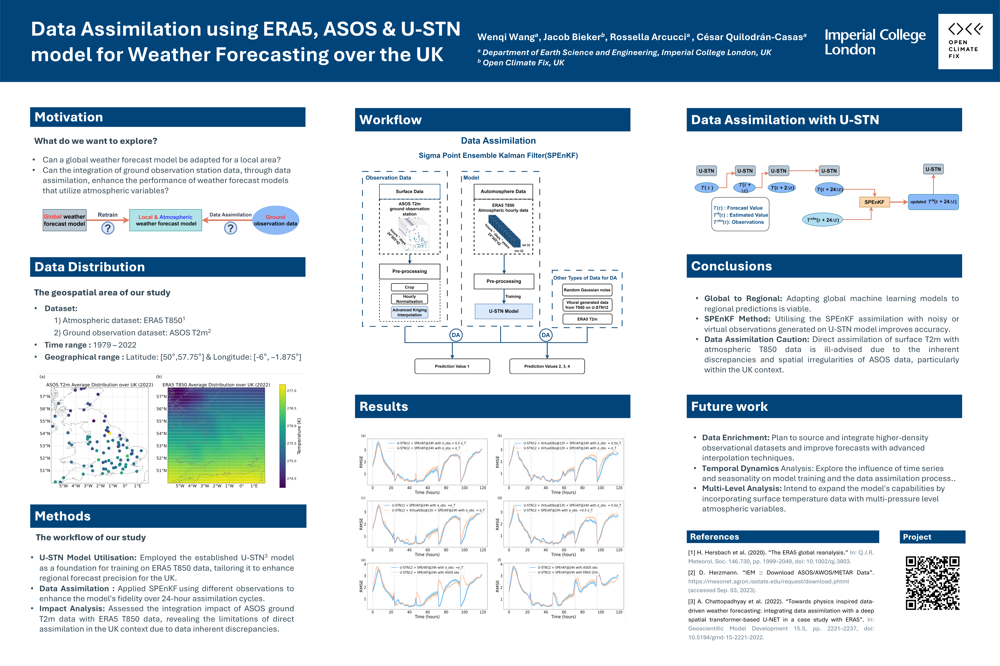

## Asimilación de Datos de ERA5 y ASOS con el modelo U-STN para Pronóstico del Tiempo en la región del Reino Unido

### Autor: Wenqi Wang

Contenido
---------------------

<!-- TOC -->

1. [Introducción](#introduction)
2. [Estructura del Proyecto](#project-structure)
3. [Dependencias](#dependencies)
4. [Datos](#data)
5. [Modelo de Predicción](#prediction-model)
6. [Asimilación](#assimilation)
7. [Visualización](#visualization)
8. [Contribuyentes](#contributors)
9. [Citación](#citation)
10. [Licencia](#license)

<!-- TOC -->

Introducción
------------

En los últimos años, la integración de modelos de aprendizaje automático basados en datos con la Asimilación de Datos (DA) ha generado un interés significativo para mejorar el rendimiento de los modelos en el pronóstico del tiempo. Este estudio se adentra en esta tendencia, detallando nuestro enfoque y hallazgos. Utilizamos los datos locales de ERA5 T850 del Reino Unido y volvimos a entrenar el modelo global de pronóstico del tiempo, USTN12, para mejorar su precisión en la predicción de temperaturas específicas de la región del Reino Unido. Adquirimos datos de t2m (temperatura a 2 metros) de las estaciones de observación terrestre ASOS en todo el Reino Unido. Aplicamos el método de kriging con término de deriva polinómica, un procedimiento geoestadístico avanzado, para la interpolación y lograr una resolución uniforme. Además, basándonos en los datos de ERA5 T850, se generó ruido gaussiano de manera aleatoria, sentando las bases para las observaciones virtuales subsiguientes en múltiples pasos de tiempo. Para investigar los efectos de la asimilación, asimilamos los datos de t2m de ASOS en los datos de ERA5 T850. Nuestros resultados indican que, si bien el modelo de pronóstico global original puede migrarse para adaptarse a regiones locales, el uso de datos atmosféricos para la asimilación de datos mejora notablemente el rendimiento del modelo. Sin embargo, la asimilación de la temperatura de la superficie en los datos atmosféricos contrarresta esta mejora, disminuyendo las capacidades predictivas del modelo.



Estructura del Proyecto
------------

Para una visión detallada de la estructura de directorios del proyecto, consulte el archivo `tree_structure.txt` ubicado en el directorio `utils`. Este archivo proporciona un desglose integral de la organización de archivos y directorios dentro del proyecto.


Dependencias
------------
Para configurar el entorno necesario para este proyecto utilizando Conda, siga estos pasos:

1. **Clonar el Repositorio:**

   ```bash
   git clone https://github.com/acse-ww721/DA_ML_ERA5_ASOS_Weather_Forecasting_UK.git

Para configurar el entorno requerido para este proyecto, siga las instrucciones a continuación según su sistema operativo:

1. Cree un entorno virtual de Conda en Windows o macOS

   ```bash
   conda env create -f config/env/env_win.yml
    ```
   o
    ```bash
    conda env create -f  config/env/env_mac.yml
     ```
2. Active el entorno virtual:
   ```bash
   conda activate your_environment_name
    ```
3. Instale los paquetes requeridos según su sistema operativo:

   ```bash
   pip install -r config/env/requirements_win.txt
   ```
   o
    ```bash
       conda install --file config/env/requirements_mac.txt
    ```

Datos
------------

### Fuentes de Datos

Este proyecto se basa en varias fuentes de datos principales para su análisis:

1. **Datos Horarios de Niveles de Presión de ERA5 (1940 - Presente) de CDS**:
   - El proyecto utiliza datos horarios de ERA5 en niveles de presión que abarcan desde 1940 hasta la actualidad. Este conjunto de datos puede accederse a través de la Copernicus Climate Data Store (CDS).
   - Fuente de datos: [CDS - Niveles de Presión ERA5](https://cds.climate.copernicus.eu/cdsapp#!/dataset/reanalysis-era5-pressure-levels?tab=overview).

2. **Datos Horarios de Nivel Único de ERA5 (1940 - Presente) de CDS**:
   - El proyecto también aprovecha los datos horarios de ERA5 en niveles únicos que cubren el período desde 1940 hasta la actualidad, disponibles a través de la Copernicus Climate Data Store (CDS).
   - Fuente de datos: [CDS - Niveles Únicos ERA5](https://cds.climate.copernicus.eu/cdsapp#!/dataset/reanalysis-era5-single-levels?tab=overview).

3. **Datos de Observación Horarios de ASOS (1979 - Presente)**:
   - Los datos horarios de ASOS, recopilados desde 1979 hasta la actualidad, son un componente vital de este proyecto. Estas observaciones se obtienen del programa Mesonet y pueden accederse para su descarga.
   - Fuente de datos: [Datos ASOS de Mesonet](https://mesonet.agron.iastate.edu/request/download.phtml?network=GB__ASOS).

### Recopilación de Datos

El código disponible en el directorio `src/data_collection` permite a los usuarios acceder, descargar o extraer datos de los sitios web correspondientes. Si bien el enfoque principal es la región del Reino Unido, el código está diseñado para ser adaptable para su uso en otras regiones también.

### Preprocesamiento de Datos

En la carpeta `src/data_preprocessing`, encontrará información detallada sobre los pasos específicos de preprocesamiento aplicados a los datos. Estos pasos incluyen el manejo de datos faltantes, interpolación, reescalado y limpieza de datos.

### Acceso a los Datos

Puede acceder a varios conjuntos de datos relacionados con este proyecto, incluyendo datos sin procesar, datos procesados para entrenar modelos y datos asimilados, a través del siguiente enlace de Google Drive:

[Google Drive - Project Data](https://drive.google.com/drive/folders/1JE6XWrNgVNdoxr4xXAQNjWPK_91YDCJM?usp=sharing)


Modelo de Predicción
------------

### Implementación del Modelo

El código del modelo está disponible en el directorio `src/model`. El modelo está implementado utilizando Python y se basa en la biblioteca Tensorflow.

### Entrenamiento y Validación

El modelo se entrena y valida utilizando datos de ERA5 T850 que abarcan desde 1979 hasta 2020. Con fines de validación, se emplean datos de ERA5 T850 del año 2021.

### Pruebas

El rendimiento del modelo se evalúa rigurosamente mediante pruebas, utilizando datos de ERA5 T850 del año 2022.

### Funcionalidad Predictiva

Posteriormente, el modelo se implementa para predecir valores de temperatura en las estaciones ASOS y los puntos de datos ERA5 para un intervalo de tiempo de 12 horas después.


Asimilación
------------

### Asimilación de Datos Utilizando SPEnKF

Para la asimilación de datos de ASOS, datos de modelo con ruido y datos virtuales generados en el conjunto de datos ERA5, empleamos la técnica del Filtro de Kalman Ensamble de Puntos Sigma (SPEnKF).

### Implementación

El código responsable del proceso de asimilación se puede encontrar en el directorio `src/assimilation`. Este procedimiento de asimilación está implementado en Python.

### Inspiraciones

Nuestra metodología de asimilación se inspira en el trabajo de [@ashesh6810](https://github.com/ashesh6810/DDWP-DA). Sus contribuciones han influido en el desarrollo de nuestro enfoque de asimilación.

Visualización
------------

Puede acceder a todo el código relacionado con la parte de visualización en el directorio `src/visualization`. El código está implementado en Python y se basa en la biblioteca Matplotlib.

Citación
------------
Si considera útil este repositorio para su investigación, tenga en cuenta citar el siguiente artículo:

```bibtex
  @inproceedings{wang2023data,
  title={Data Assimilation using ERA5, ASOS, and the U-STN model for Weather Forecasting over the UK},
  author={WANG, WENQI and Bieker, Jacob and Arcucci, Rossella and Quilodran-Casas, Cesar},
  booktitle={NeurIPS 2023 Workshop on Tackling Climate Change with Machine Learning},
  url={https://www.climatechange.ai/papers/neurips2023/61},
  year={2023}
}

```

Contribuyentes
------------
Para cualquier consulta o problema con el código, no dude en contactarme:

* [Wang, Wenqi](mailto:wenqi.wang21@imperial.ac.uk)

LICENCIA
------------
Este proyecto está licenciado bajo los términos de la licencia Apache 2.0. Consulte el archivo [LICENSE](LICENSE) para obtener más detalles.
